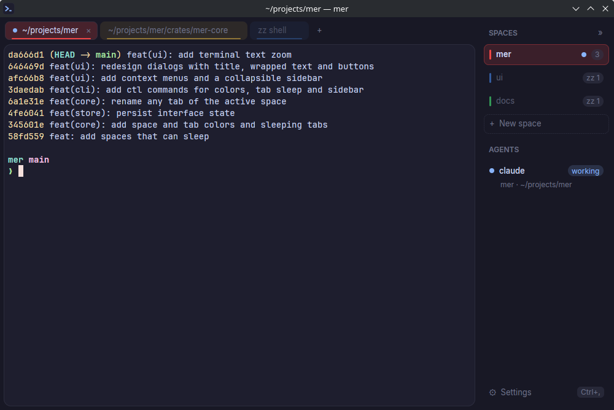
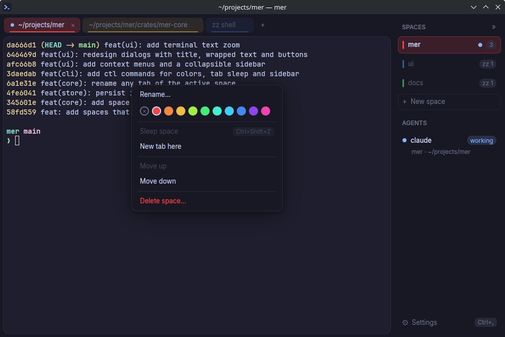
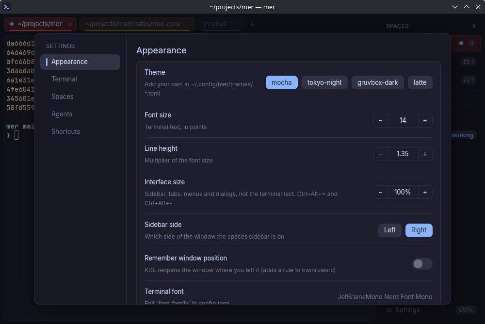
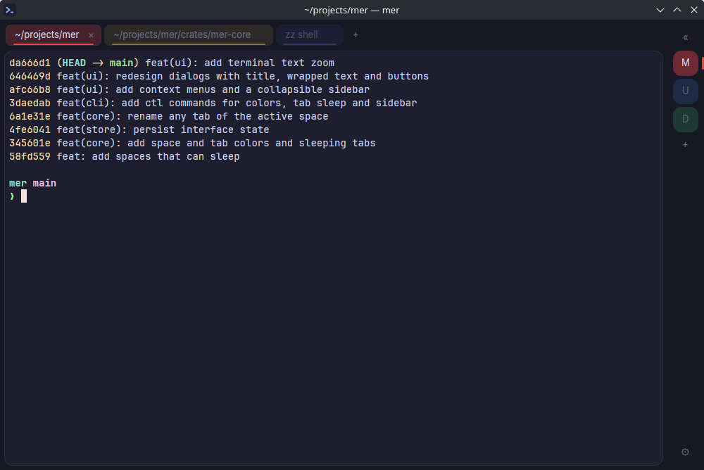

# mer

**mer** es un emulador de terminal para Linux escrito completamente en Rust. Está pensado
para trabajar con agentes de programación (Claude Code, Codex CLI, Gemini CLI, opencode) sin
perder rapidez: arranca en unos 300 ms, no gasta CPU en reposo y deja *dormir* los espacios de
trabajo que no estás usando.



[](https://github.com/rodasOS/mer/actions/workflows/ci.yml)
[](https://github.com/rodasOS/mer/actions/workflows/audit.yml)
[](LICENSE)

> **Estado del proyecto.** `mer` es un proyecto personal, en desarrollo (versión 0.1). Está
> hecho y probado en **Fedora 44, KDE Plasma sobre Wayland, GPU AMD (RADV)**. Hay paquetes
> `.rpm` y `.deb` para Linux x86-64 (con soporte de Wayland y de X11, este último sin probar en
> uso real); no hay versión para macOS ni Windows. Puede haber aristas: ver
> [Límites conocidos](#límites-conocidos).

**Contenido:** [Qué hace](#qué-hace) · [Instalación](#instalación) · [Uso](#uso) ·
[Configuración](#configuración) · [Seguridad y privacidad](#seguridad-y-privacidad) ·
[Desarrollo](#desarrollo) · [Límites conocidos](#límites-conocidos)

## Por qué existe

Los terminales con muchas funciones se vuelven pesados, y los multiplexores externos añaden
otra capa. `mer` busca lo contrario: un solo proceso, rápido y ligero, con las pocas
funciones que de verdad hacen falta al trabajar con varios proyectos y agentes a la vez.

## Qué hace

- **Rápido y ligero.** Dibuja con la GPU (GPUI sobre Vulkan) y usa el motor de terminal de
  Alacritty. Medido con `cat` de 64 MiB dentro de la ventana: 1,67 s, frente a 1,80 s de kitty
  y 2,08 s de ghostty. 0 % de CPU en reposo. Los números y cómo se midieron están en
  [`docs/performance.md`](docs/performance.md).
- **Espacios que duermen.** Un *espacio* agrupa pestañas y paneles de un proyecto. Al dormirlo
  se detienen sus procesos y no consume nada; `mer` recuerda cuántas terminales tenía, en qué
  carpeta estaba cada una y su historial. Al volver a entrar se abren de nuevo, en la misma
  carpeta y con el historial a la vista. También se pueden dormir pestañas sueltas, o dormir
  automáticamente los espacios que no visitas hace un rato.
- **Pestañas y paneles divididos** dentro de cada espacio, con colores propios para distinguir
  espacios y pestañas de un vistazo.
- **Detección de agentes.** `mer` sabe qué agente corre en cada terminal y qué hace
  (trabajando, esperando tu respuesta, terminado), por el proceso en primer plano y, con más
  detalle, por los *hooks* del agente. Te avisa con una notificación de KDE cuando uno te
  necesita y la ventana no está al frente. Opcionalmente reanuda la sesión de Claude Code al
  despertar un espacio.
- **Seguir corriendo con la ventana cerrada** (opcional). Cierras la ventana y tus terminales
  siguen trabajando; vuelves con `mer`.
- **Arrastrar y soltar:** reordena pestañas y espacios arrastrándolos, o suelta una pestaña
  sobre otro espacio para mandarla allí (con sus terminales vivos).
- **Buscar en el historial** de la terminal con `Ctrl+Shift+F`: resalta los resultados, los
  cuenta y salta entre ellos.
- **Avisos que no estorban:** notificación y un sonido (con volumen ajustable) cuando un agente
  te necesita o termina, y cuando un comando largo acaba mientras mirabas otra cosa.
- **Menús con clic derecho** sobre espacios, pestañas, terminales y la barra lateral.
- **Barra lateral** a la derecha (o a la izquierda), plegable y con ancho ajustable; zoom del
  texto y de la interfaz, paleta de comandos y selección con el mouse
  (también dentro de programas como vim o htop, con `Shift`).
- **Panel de ajustes** gráfico, temas en TOML y recarga en caliente de la configuración.

| Menú contextual | Ajustes | Barra lateral plegada |
|---|---|---|
|  |  |  |

## Instalación

Hay dos caminos. El **paquete** es lo más rápido; **compilar** da un binario optimizado para tu
procesador.

| | Paquete `.rpm` / `.deb` | Compilar desde el código |
|---|---|---|
| Hace falta | Solo instalarlo | Rust, un compilador de C y `git` |
| Tarda | Segundos | Varios minutos la primera vez |
| Optimizado para | Cualquier x86-64 desde ~2009 | Tu procesador (`native`) |
| Se actualiza | Descargando el siguiente paquete | `git pull` y `cargo xtask install` |

### Requisitos (en cualquier caso)

- Linux x86-64 con **Wayland** (o X11 con el paquete o con `--features x11`) y un driver
  **Vulkan** que funcione. Para comprobarlo: `vulkaninfo --summary` (viene en `vulkan-tools`).
- Las fuentes **JetBrainsMono Nerd Font Mono** (terminal) e **Inter** (interfaz). Se pueden
  cambiar en la configuración; si no están, se usa otra del sistema. `mer` no las incluye.
- Opcional: un servicio de notificaciones del escritorio (D-Bus) para los avisos, y KDE para la
  regla que recuerda la posición de la ventana.

### Opción 1: instalar el paquete

1. Descarga el `.rpm` o el `.deb` desde [Releases](https://github.com/rodasOS/mer/releases),
   junto con `SHA256SUMS`.
2. Comprueba que no se corrompió (desde la carpeta donde los descargaste):

   ```sh
   sha256sum -c SHA256SUMS --ignore-missing
   ```

3. Instálalo; el gestor de paquetes trae las librerías que falten:

   ```sh
   sudo dnf install ./mer-*.rpm      # Fedora y derivadas
   sudo apt install ./mer_*.deb      # Debian, Ubuntu y derivadas
   ```

4. Ábrelo desde el lanzador de aplicaciones o escribe `mer` (queda en `/usr/bin/mer`).
   `mer --version` confirma la versión instalada.

Para desinstalar: `sudo dnf remove mer` o `sudo apt remove mer`. Tu configuración
(`~/.config/mer`) y tus espacios (`~/.local/state/mer`) no se borran; elimínalos a mano si
quieres empezar de cero.

Los paquetes se compilan con el nivel `x86-64-v2` y sin PGO, y con X11 además de Wayland. Solo
se probaron en Fedora 44 con KDE Plasma sobre Wayland; el resto de distribuciones y X11
compilan, pero no se han probado en uso real.

**Windows:** no hay `.exe` todavía. mer usa sockets Unix, `/proc` y herramientas de audio de
Linux; el trabajo pendiente está en [TODO.md](TODO.md). Existe un workflow manual
(`release-windows.yml`) que fallará hasta que se haga ese port.

### Opción 2: compilar desde el código

**Herramientas.** Instala [Rust](https://rustup.rs) (el repositorio fija la versión en
`rust-toolchain.toml`, 1.96, y `rustup` la descarga sola), un compilador de C y `git`. SQLite se
compila dentro de `mer` y GPUI se descarga desde GitHub, así que hace falta red la primera vez.

En la máquina de desarrollo (Fedora) no hizo falta instalar nada más: fontconfig se carga en
tiempo de ejecución, sin paquetes `-dev`. En Debian y Ubuntu, la integración continua usa estas
librerías de desarrollo:

```sh
sudo apt install build-essential pkg-config libwayland-dev libxkbcommon-dev \
  libxkbcommon-x11-dev libxcb1-dev libvulkan-dev libfontconfig-dev libssl-dev
```

(`libxkbcommon-x11-dev` y `libxcb1-dev` solo se necesitan con `--features x11`.) En otras
distribuciones busca los paquetes equivalentes de Wayland, xkbcommon, xcb, Vulkan y fontconfig.

**Compilar e instalar:**

```sh
git clone https://github.com/rodasOS/mer.git
cd mer
cargo xtask install
```

Esto compila en modo *release* y copia el binario a `~/.local/bin/mer`, una entrada de
escritorio y un icono. Asegúrate de que `~/.local/bin` esté en tu `PATH`. Si lo prefieres, solo
compila (`cargo build --release`) y usa `target/release/mer`.

Para una versión ~12 % más rápida, optimizada con perfil (PGO):

```sh
cargo xtask pgo            # tarda ~25 min
cargo xtask install --pgo
```

Para desinstalar: `cargo xtask uninstall`.

### Compilar para tu CPU

`cargo xtask install` (y `cargo run`) compilan con `-C target-cpu=native`, definido en
`.cargo/config.toml`: el binario queda optimizado para **tu** procesador y no es portable a
otro equipo. Compílalo en la máquina donde lo vas a usar.

Si quieres otro objetivo, por ejemplo un binario que corra en cualquier PC, la variable
`RUSTFLAGS` reemplaza lo que dice `.cargo/config.toml`:

```sh
# Portable (lo mismo que usan los paquetes de Releases)
RUSTFLAGS="-C target-cpu=x86-64-v2" cargo build --release --features x11

# Equipos de ~2013 en adelante (AVX2): un poco más rápido, se cierra en CPUs más viejas
RUSTFLAGS="-C target-cpu=x86-64-v3" cargo build --release --features x11
```

El binario queda en `target/release/mer`. Quita `--features x11` si solo usas Wayland: así no
hacen falta las librerías de X11. Para ver los nombres de procesador que acepta LLVM:
`rustc --print target-cpus`.

Para generar tú mismo los paquetes (después de compilar como arriba):

```sh
cargo install --locked cargo-deb cargo-generate-rpm
cargo deb --no-build --no-strip -p mer       # target/debian/*.deb
cargo generate-rpm -p crates/mer             # target/generate-rpm/*.rpm
```

### Si no abre

- **No aparece ninguna ventana y no hay error:** puede haber ya una instancia corriendo (quizá
  con la ventana cerrada, ver *Seguir corriendo con la ventana cerrada*). `mer` muestra la de esa
  instancia; `mer quit` la cierra del todo.
- **Se cierra al arrancar o sale un error de GPU:** comprueba que Vulkan funciona
  (`vulkaninfo --summary`) y que tienes el driver de tu tarjeta instalado.
- **El texto se ve raro o faltan iconos:** instala *JetBrainsMono Nerd Font Mono* o cambia
  `appearance.font_family` en `~/.config/mer/config.toml`.
- **`mer: command not found` tras compilar:** añade `~/.local/bin` a tu `PATH`.

## Uso

Ejecuta `mer` (o ábrelo desde el lanzador). Si ya hay una instancia corriendo, `mer` solo
muestra su ventana.

### Espacios, pestañas y paneles

- **Espacio nuevo:** `Ctrl+Shift+N` o `+ New space` en la barra lateral. Cada espacio nuevo
  recibe un color distinto.
- **Pestaña nueva:** `Ctrl+Shift+T`. **Dividir:** `Ctrl+Shift+D` (derecha) y
  `Ctrl+Shift+E` (abajo). **Cerrar panel:** `Ctrl+Shift+W`.
- **Dormir un espacio:** `Ctrl+Shift+Z`, o clic derecho sobre él. Un espacio dormido aparece
  atenuado con `zz` y el número de terminales que tiene. **Despertar:** haz clic en él.
- **Nombre de la pestaña:** muestra el programa que corre (`npm run dev`, `vim notas.md`) con
  la carpeta al lado; para el comando exacto, activa la integración de shell (ver
  [docs/agentes.md](docs/agentes.md)).
- **Dormir una pestaña:** clic derecho sobre ella → *Sleep tab*.
- **Colores:** clic derecho sobre un espacio o una pestaña → fila de colores.
- **Borrar un espacio** (con su historial guardado): clic derecho → *Delete space…*.

Una terminal con un programa en marcha (un servidor, un agente) pide confirmación antes de
dormirse, y el sueño automático la salta.

### Teclado y mouse

Los atajos completos están en [`docs/atajos.md`](docs/atajos.md). Los más usados:

| Atajo | Acción |
|---|---|
| `Ctrl+Shift+P` | Paleta de comandos |
| `Ctrl+,` | Ajustes |
| `Ctrl+Shift+B` | Plegar o desplegar la barra lateral |
| `Ctrl+Shift+F` | Buscar en el historial de la terminal |
| `Ctrl+=` / `Ctrl+-` / `Ctrl+0` | Zoom: acercar, alejar, restablecer (también `Ctrl` + rueda) |
| `Ctrl+Shift+C` / `Ctrl+Shift+V` | Copiar / pegar |
| `Ctrl+Shift+Q` | Salir de `mer` y cerrar todo |

Seleccionar con el mouse copia a la selección primaria; el botón del medio pega. Un doble clic
selecciona una palabra y un triple clic, la línea. `Shift+Enter` inserta un salto de línea en
Claude Code y otros agentes (sin enviar el mensaje).

**Al pegar**, `mer` quita los caracteres de control del texto (Esc, Ctrl+C…) y evita que pueda
cerrar antes de tiempo el "pegado entre corchetes". Así, un comando copiado de una web no se
ejecuta solo ni puede colar teclas: solo se escribe el texto, y tú pulsas Enter.

### Agentes

`mer` detecta por sí solo `claude`, `codex`, `gemini` y `opencode`. Para ver su estado exacto
(trabajando, esperando, terminado) instala los *hooks* desde **Ajustes → Agents**: el botón
*Preview install…* muestra qué se va a cambiar en `~/.claude/settings.json` o
`~/.codex/config.toml` antes de tocar nada, y guarda una copia `.bak-mer`. Más detalle en
[`docs/agentes.md`](docs/agentes.md).

### Seguir corriendo con la ventana cerrada

Activa **Ajustes → Spaces → Keep running when the window closes**. Al cerrar la ventana,
`mer` queda en segundo plano con tus terminales vivas (no se ve en ninguna bandeja). Para
volver: ejecuta `mer`. Para cerrarlo todo de verdad: `Ctrl+Shift+Q`, `mer quit` o *Quit mer*
en el menú de la barra lateral. Viene **apagada**: sin ella, cerrar la ventana cierra `mer`.

### Línea de comandos

```text
mer                         abre la ventana (o muestra la de la instancia que ya corre)
mer -e PROGRAMA [ARGS…]     abre una ventana aparte ejecutando ese programa
mer quit                    cierra la instancia que corre, con todo lo que tenga dentro
mer hook --agent claude     lo llaman los hooks del agente (no se usa a mano)
mer ctl …                   controla la instancia que corre
```

`mer ctl` sirve para automatizar y para probar sin mouse:

```text
mer ctl space list | new [--cwd DIR] | sleep [N] | wake N | delete N | color N [COLOR]
mer ctl tab   sleep N | color N [COLOR] | move DESDE A | to-space PESTAÑA ESPACIO
mer ctl space move DESDE A
mer ctl open DIR            abre una pestaña en esa carpeta
mer ctl search [TEXTO]      busca en la terminal enfocada (sin texto, cierra la barra)
mer ctl sidebar collapse|expand
mer ctl zoom in|out|reset
mer ctl ui-scale in|out|reset      # tamaño de la interfaz
mer ctl sidebar-width 300
mer ctl window | close-window | quit
mer shell-init zsh          integración de shell (nombre exacto del comando en las pestañas)
mer ctl show settings|palette|space-menu|tab-menu|pane-menu|sidebar-menu
```

Colores: `red orange amber lime green teal cyan blue violet pink none`.

## Configuración

Todo se puede cambiar desde el panel de ajustes (`Ctrl+,`) o editando
`~/.config/mer/config.toml`; los cambios se aplican al instante y `mer` conserva tus
comentarios al guardar. Referencia completa en [`docs/configuracion.md`](docs/configuracion.md).

```toml
[appearance]
theme = "mocha"                       # mocha, tokyo-night, gruvbox-dark, latte o uno tuyo
font_family = "JetBrainsMono Nerd Font Mono"
font_size = 14

[terminal]
shell = "/usr/bin/zsh"                # sin esto, zsh si existe y si no tu shell de login

[spaces]
auto_sleep_minutes = 0                # 0 = nunca dormir solo
keep_running_on_close = false

[keys]
new_tab = "ctrl-t"                    # cambiar un atajo; "" lo desactiva
```

Dónde guarda cosas `mer`:

| Qué | Dónde |
|---|---|
| Configuración y temas | `~/.config/mer/` |
| Espacios, pestañas y estado | `~/.local/state/mer/state.db` (SQLite) |
| Historial de las terminales | `~/.local/state/mer/scrollback/*.zst` |
| Socket de control | `$XDG_RUNTIME_DIR/mer/mer.sock` |

La carpeta de estado se crea privada (`0700`) y sus archivos solo legibles por ti (`0600`). El
historial no está cifrado: si en una terminal apareció un secreto, también queda ahí; bórralo con
*Delete space…* o eliminando `scrollback/`.

## Seguridad y privacidad

- `mer` **no abre conexiones de red propias**; las notificaciones usan el D-Bus local.
- El socket de control es de tu usuario (`0600`, en una carpeta `0700`) y no permite ejecutar
  comandos ni leer o escribir en tus terminales.
- Los hooks de los agentes solo se instalan si lo pides, enseñando antes el cambio y dejando una
  copia `.bak-mer` de tu archivo original.
- Las dependencias se vigilan con `cargo deny` y Dependabot en cada cambio y cada semana, sin
  vulnerabilidades reportadas. Algunas librerías de GPUI figuran como "sin mantenimiento"
  (están anotadas en [`TODO.md`](TODO.md)).

Detalle completo y cómo reportar un problema en [`SECURITY.md`](SECURITY.md).

## Cómo está hecho

Un workspace de Cargo con un crate por responsabilidad. Solo `mer-ui` (y el binario) dependen
de la interfaz gráfica, así que el resto se prueba sin abrir ninguna ventana:

| Crate | Qué hace |
|---|---|
| `mer-core` | El modelo: espacios, pestañas, paneles, divisiones y colores. |
| `mer-term` | Una sesión de terminal: PTY, motor de Alacritty, mouse, historial. |
| `mer-agents` | Detección de agentes y de sus hooks. |
| `mer-store` | SQLite y los archivos de historial comprimidos con zstd. |
| `mer-config` | Esquema de la configuración, temas y recarga en caliente. |
| `mer-ipc` | El socket de control entre `mer ctl`, los hooks y la ventana. |
| `mer-ui` | La interfaz con GPUI (el framework de Zed). |
| `mer` | El binario y su línea de comandos. |
| `xtask` | Tareas del proyecto: instalar, PGO, medir, CI. |

Más en [`docs/arquitectura.md`](docs/arquitectura.md). Las decisiones importantes están
registradas en [`docs/adr/`](docs/adr).

## Desarrollo

```sh
cargo xtask ci        # formato, clippy y tests, igual que la integración continua
cargo run             # compila y abre mer (usa TU estado; ver CONTRIBUTING.md)
cargo xtask bench     # mide rendimiento y escribe docs/performance.md
cargo deny check      # vulnerabilidades, licencias y fuentes de las dependencias
```

Hay más de 200 tests y `clippy` en modo estricto (`-D warnings`, con lints `pedantic`). Guía
para contribuir en [`CONTRIBUTING.md`](CONTRIBUTING.md); historial de cambios en
[`CHANGELOG.md`](CHANGELOG.md).

**Publicar una versión** (quien mantiene el repo): sube la versión en `Cargo.toml`, haz commit
y crea una etiqueta. El workflow `release.yml` compila el `.rpm` y el `.deb` y los adjunta a la
Release de GitHub con sus sumas SHA256:

```sh
git tag -a v0.2.0 -m "v0.2.0"
git push origin v0.2.0
```

## Límites conocidos

- Probado únicamente en Fedora 44 con KDE Plasma sobre Wayland. X11 (feature `x11`) y otras
  distribuciones compilan pero no se han probado. No hay versión para Windows ni macOS.
- Faltan el protocolo de teclado de Kitty, los enlaces clicables (OSC 8) y arrastrar los
  divisores con el mouse.
- Reanudar un agente al despertar solo funciona con Claude Code.
- Wayland no permite que una aplicación lea ni fije la posición de su ventana. Para recordarla
  hay un botón en Ajustes que instala una regla de KDE; no está comprobado que KWin la respete.
- Con *Keep running* activado, si `mer` se cae, las terminales mueren con él (no hay un
  demonio aparte; ver [ADR 0005](docs/adr/0005-view-outlives-window.md)).
- Ejecutar `mer` con la ventana ya abierta no la trae al frente.

## Licencia

[MIT](LICENSE) © 2026 rodasOS.
